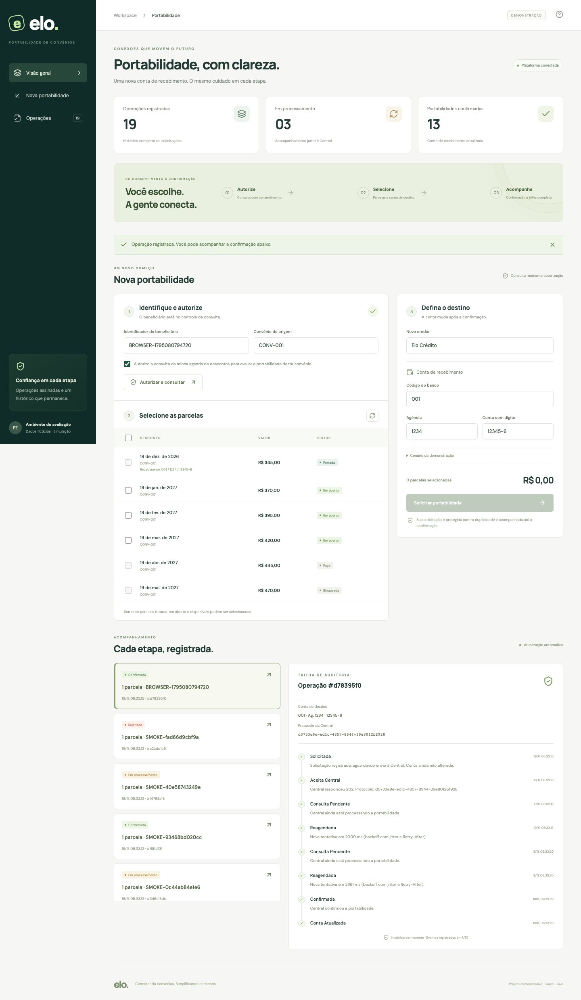
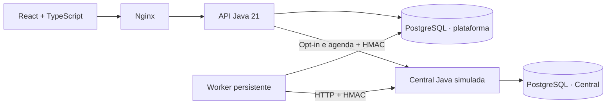

# Elo · Portabilidade de convênios

Plataforma fullstack para simular portabilidade de convênios de desconto em folha: consentimento → agenda → seleção → solicitação → confirmação assíncrona → atualização da conta, com histórico auditável.

**Monorepo:** frontend React/TypeScript e backend Java 21 no mesmo repositório. A Central simulada roda em outro processo Java, com HTTP assinado e banco separado.



## Executar em Docker

Requisitos: Docker Engine/Desktop com Docker Compose v2, acesso à internet no primeiro build e aproximadamente 3 GB de RAM disponíveis.

```sh
git clone https://github.com/pzamproni/portabilidade-convenios.git
cd portabilidade-convenios
cp .env.example .env
docker compose up --build -d --wait --wait-timeout 180
```

Abra **http://localhost:8088**. Nesta máquina, o Compose é um binário separado: use `docker-compose` no lugar de `docker compose` se necessário. O primeiro build baixa dependências e executa os testes; pode levar alguns minutos. Os quatro serviços devem estar `healthy`.

`.env.example` contém valores exclusivamente locais e demonstrativos. Para outro ambiente, gere `DATABASE_PASSWORD` e `HMAC_SECRET` distintos com `openssl rand -hex 32`. O segredo HMAC precisa ter pelo menos 32 caracteres. O frontend nunca recebe esse segredo.

```sh
docker compose ps
docker compose logs -f api central
docker compose down       # preserva os dados no volume
```

`docker compose down -v` remove os dados de demonstração. A porta web fica vinculada a `127.0.0.1`; Postgres, API e Central não publicam portas no host por padrão. Os Dockerfiles de Java e React são **multistage**, executam testes no build e usam usuários sem privilégios no runtime.

## Demonstração em 2 minutos

1. Mantenha `BEN-001` e `CONV-001`, marque o consentimento e clique em **Autorizar e consultar**.
2. A Central cria seis parcelas fictícias por beneficiário/convênio: quatro abertas, uma paga e uma bloqueada. Escolha uma ou mais abertas.
3. Informe banco `001`, agência `1234`, conta `12345-6` e solicite a portabilidade.
4. A API registra a intenção local em `RECEBIDA`. O worker recebe o protocolo remoto e muda para `PENDENTE`. A Central confirma após aproximadamente 6 segundos; o polling e o backoff podem acrescentar alguns segundos.
5. A conta passa a aparecer na agenda somente após `CONFIRMADA`. Na trilha, confira protocolo, consultas, falhas e atualização da conta.
6. Para explorar outro caso, use outro beneficiário, por exemplo `BEN-002`, e abra **Cenário da demonstração**.

| Cenário | Comportamento |
|---|---|
| Confirmação normal | Retorna 202 e protocolo; 204 + Retry-After enquanto processa; depois confirma. |
| Rejeição | Finaliza REJEITADA com motivo, mantém conta anterior e libera a reserva. |
| Indisponibilidade | Duas respostas 503 e posterior recuperação. |
| Timeout | Duas respostas lentas; reenvio mantém a chave. |
| Timeout depois do aceite | Primeira chamada persiste remotamente e demora além do timeout; retry recupera o mesmo protocolo. |
| Resposta inesperada | Duas respostas com conteúdo inválido; retry e auditoria. |
| Assinatura inválida | Duas respostas adulteradas; o cliente recusa o conteúdo e reenvia com a mesma chave. |

Falhas são determinísticas por chave idempotente para permitir reprodução. Após seis tentativas por fase, a operação vai para `REVISAO_NECESSARIA`; o botão **Retomar com segurança** preserva chave, parcelas e protocolo. O limite também se aplica a respostas ainda pendentes, evitando polling infinito. Falha técnica nunca vira rejeição de negócio automaticamente.

## Arquitetura e garantias



- **Transação inicial:** cria operação e reservas exclusivas das parcelas. UNIQUE na chave e nas reservas elimina duplicidade e disputa entre operações. Reenvio com conteúdo diferente retorna 409; ordem das parcelas é normalizada.
- **Intenção durável:** a própria operação funciona como fila/outbox. O worker encontra registros vencidos após reinício; `SELECT FOR UPDATE` e rechecagem do estado evitam processamento concorrente do mesmo registro.
- **Idempotência ponta a ponta:** a chave original é persistida e enviada à Central. A Central tem sua própria unicidade e fingerprint do payload. Timeout após aceite não cria outro protocolo.
- **Confirmação:** grava estado, conta e eventos numa única transação local. Estados finais não são reprocessados. Rejeição libera reservas; confirmação mantém a proteção contra nova portabilidade da mesma parcela.
- **Integração:** timeout de 1,2 s, backoff exponencial com jitter, teto de 30 s, Retry-After limitado a 300 s e seis tentativas por fase. Consultas/consentimento são síncronos e exibem falhas imediatamente; o retry durável aplica-se à operação.
- **Integridade:** HMAC-SHA256 verifica requisições e respostas, incluindo bytes exatos, método/caminho, timestamp e nonce. Chave idempotente também é assinada; janela de 5 minutos; comparação em tempo constante. Nonce vincula a resposta à requisição; não há cache global de nonces, e replay mutante é neutralizado por idempotência/opt-in único.
- **Auditoria:** append-only, com sequência e timestamp UTC; trigger PostgreSQL impede UPDATE/DELETE. Estado e eventos compartilham transação. Não é um ledger contra administrador do banco.

Os bancos são separados logicamente no mesmo Postgres, sem transação distribuída. Durante a confirmação remota pode existir uma pequena janela antes da atualização local; retry idempotente converge os estados.

## SDD e documentação técnica

O primeiro commit contém as especificações antes da implementação:

- [Requisitos e critérios de aceite](specs/01-requisitos.md)
- [Contratos e máquina de estados](specs/02-contratos.md)
- [Critérios de aceite em Gherkin](specs/acceptance.feature) — 47 cenários com teste individual
- [Rastreabilidade cenário → teste](specs/acceptance-map.json)
- [Plano de verificação](specs/03-plano-verificacao.md)
- [Decisões arquiteturais e trade-offs](docs/adr.md)
- [Resultados verificados e limitações](docs/verification.md)
- [Demonstração manual dos sete cenários](docs/evidence/demonstracao-manual.json)

A implementação usa IA como apoio a especificação, código e testes. As evidências vêm de execução real; o relatório registra as correções identificadas durante a validação. Nenhuma API de IA é necessária para executar o produto.

## Testes

Java 21 e Node 22.12+ para execução local dos testes. O Maven Wrapper baixa a versão fixada do Maven.

```sh
./mvnw -B -f backend/pom.xml verify
cd frontend
npm ci
npm test
npm run build
npx playwright install chromium
npm run test:e2e         # exige Compose em http://localhost:8088
cd ..
python3 scripts/smoke.py # sete cenários HTTP com concorrência, sobre PostgreSQL
python3 scripts/persistence.py # reinício e verificação da auditoria imutável
python3 scripts/check_acceptance.py --results # cruza Gherkin com resultados reais
```

Se usar o binário Compose separado, rode `COMPOSE_COMMAND=docker-compose python3 scripts/persistence.py`.

Os testes Java incluem H2 para transações rápidas e um servidor HTTP real para contrato/HMAC/erros da Central. `smoke.py` exercita PostgreSQL real, seis submissões simultâneas por cenário, conteúdo conflitante, reserva e conta antes/depois da confirmação. Playwright verifica consentimento, seleção, sucesso, rejeição e ausência de overflow em 390 px. Os testes criam somente dados fictícios, com identificadores únicos, sem apagar dados existentes.

CI em [`.github/workflows/ci.yml`](.github/workflows/ci.yml): Java, frontend, build Docker, cenários PostgreSQL e navegador, com relatórios como artefatos.

## Executar cada parte fora do Docker

Para desenvolvimento híbrido, publique apenas a porta de Postgres usando o override:

```sh
cp .env.example .env
docker compose -f compose.yml -f compose.dev.yml up -d database
set -a; . ./.env; set +a
```

Em terminais separados, exporte as variáveis de `.env` e execute:

```sh
# Central
APP_ROLE=central PORT=8081 DATABASE_URL=jdbc:postgresql://localhost:5433/central \
DATABASE_USER=portabilidade ./mvnw -f backend/pom.xml spring-boot:run
```

```sh
# API
APP_ROLE=api PORT=8080 DATABASE_URL=jdbc:postgresql://localhost:5433/portabilidade \
DATABASE_USER=portabilidade CENTRAL_URL=http://localhost:8081 \
./mvnw -f backend/pom.xml spring-boot:run
```

```sh
# Frontend (http://localhost:5173, proxy /api para 8080)
cd frontend
npm ci
npm run dev
```

Healthchecks locais: `http://localhost:8080/actuator/health` e `http://localhost:8081/actuator/health`. Não há CORS permissivo: o frontend usa proxy em desenvolvimento e no Nginx.

## API resumida

| Método | Endpoint | Resultado |
|---|---|---|
| POST | `/api/autorizacoes` | 201, autorização única por beneficiário/convênio |
| GET | `/api/beneficiarios/{id}/agenda` | 200; 403 sem opt-in |
| POST | `/api/operacoes` | 202 + Location; header Idempotency-Key obrigatório |
| GET | `/api/operacoes` | Histórico das operações com eventos |
| GET | `/api/operacoes/{id}` | Estado, protocolo, tentativas, erros e eventos |
| POST | `/api/operacoes/{id}/retomar` | 202 para revisão necessária; 409 nos demais estados |

Exemplo de operação, após autorização e obtenção de um `parcelaId` real da agenda:

```json
{
  "beneficiarioId": "BEN-001",
  "parcelas": ["id-retornado-pela-agenda"],
  "credorCessionario": "Elo Crédito",
  "contaRecebimento": {"banco": "001", "agencia": "1234", "conta": "12345-6"},
  "cenario": "NORMAL"
}
```

Erros seguem `{ "code": "CHAVE_REUTILIZADA", "message": "..." }`. Consulte [o contrato completo](specs/02-contratos.md).

## Bibliotecas e justificativas

| Tecnologia | Uso e motivo |
|---|---|
| Java 21 / Spring Boot 3.5.16 | Records, validação, servidor HTTP, configuração e scheduling maduros. |
| Spring JDBC / PostgreSQL 17 | SQL e locks explícitos para discutir invariantes no code review. |
| Flyway | Migrações reproduzíveis, incluindo proteção da trilha. |
| Java HttpClient / JCA | HTTP com timeout e HMAC sem dependências extras. |
| React 19 / TypeScript / Vite | UI tipada, componentes e build estático enxuto. |
| Lucide | Ícones consistentes e importação somente dos usados. |
| JUnit / Mockito / AssertJ / H2 / JaCoCo | Testes de invariantes, falhas e cobertura inspecionável. |
| Vitest / Testing Library / Playwright | Comportamento de formulários, idempotência do navegador e jornadas reais. |
| Nginx unprivileged | Estáticos e proxy no mesmo origin, runtime sem Node. |

Versões Java são geridas pelo parent Maven fixado; versões JS exatas constam em `package-lock.json`. Fontes web têm fallback local; funcionalidade não depende de Google Fonts.

## Trade-offs e próximos passos

- Sem login/RBAC, tenancy e revogação/expiração do consentimento nesta simulação. Para uso real, isso vem antes da exposição do serviço.
- Worker usa lock transacional durante chamada HTTP curta: simples e recuperável, mas ocupa conexão. Evoluir para leases com expiração, outbox dedicado e métricas/alertas.
- HMAC simplificado com segredo compartilhado, sem rotação, mTLS ou certificados. TLS é necessário fora da rede local.
- Conta validada por formato; não há validação bancária real. Identificadores são fictícios; não exigimos CPF.
- Agenda e lista de operações não são paginadas; volume limitado de demonstração. Paginação, filtros e índices adicionais seriam evoluções.
- O protocolo remoto é a fonte da confirmação, com consistência eventual local. Para operação real, adicionar reconciliação periódica e políticas de intervenção.
- Separação lógica dos bancos usa o mesmo usuário no ambiente local; produção deve separar credenciais/privilégios e backups.
- Atualização da conta aplica-se às parcelas selecionadas. O simulador não representa liquidação financeira ou um sistema bancário completo.
