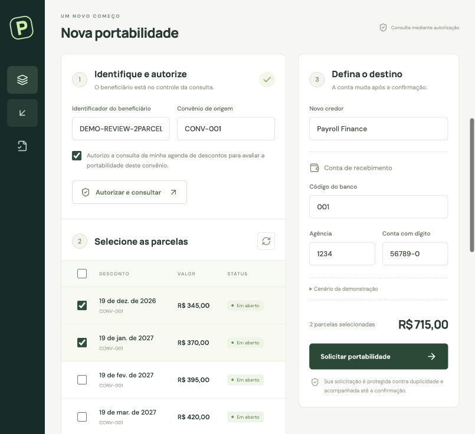
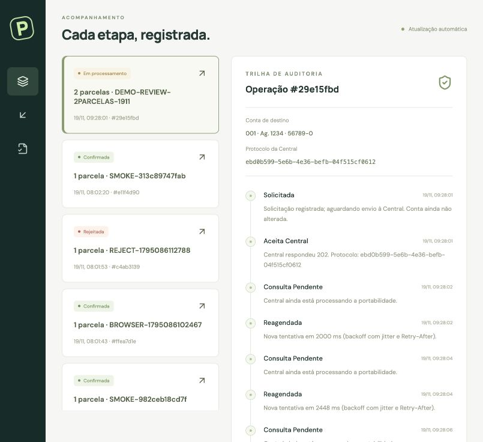
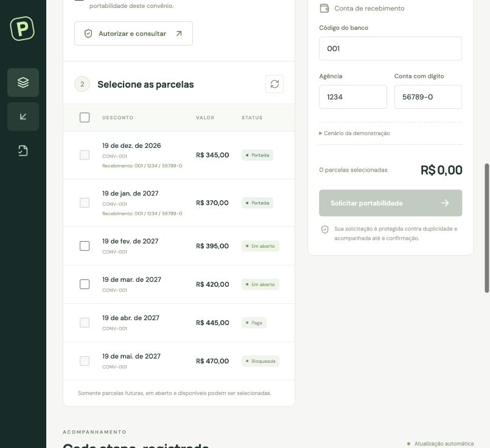
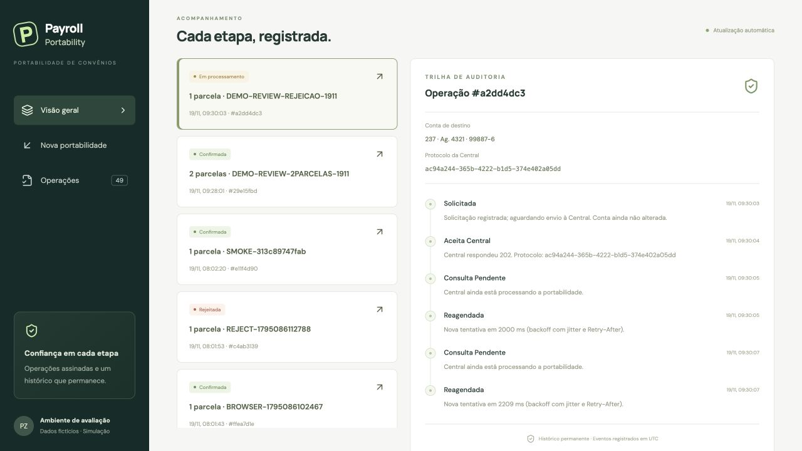
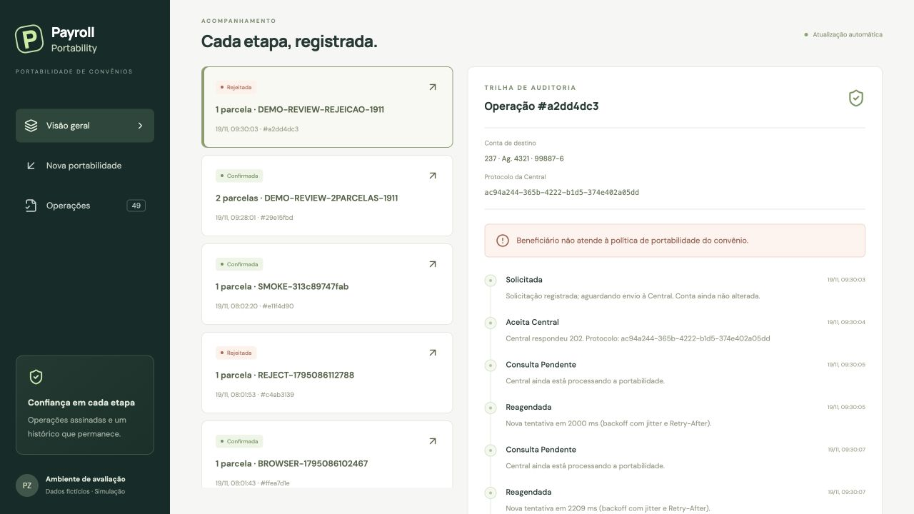
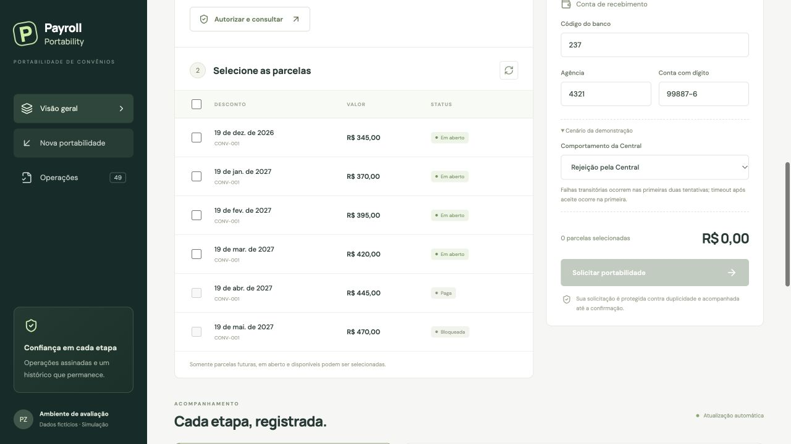

# Demonstração após a revisão

Em 19/11/2026, os dois fluxos foram executados no navegador interno sobre a revisão `b9ecae2`, com dados fictícios novos. As capturas abaixo foram feitas durante essa execução; os IDs completos, protocolos, eventos e parcelas constam no [registro estruturado](evidence/demonstracao-pos-revisao.json). Os sete cenários da demonstração anterior permanecem preservados em seu próprio registro.

## Duas parcelas até confirmação

Beneficiário `DEMO-REVIEW-2PARCELAS-1911`, convênio `CONV-001`. Após consentimento explícito, foram selecionadas duas parcelas futuras de **R$ 345,00 e R$ 370,00**, total **R$ 715,00**. Conta de destino fictícia: `001 / 1234 / 56789-0`.

1. Autorização registrada e agenda disponibilizada.
2. Seleção das duas parcelas elegíveis e preenchimento da conta.
3. Solicitação registrada como RECEBIDA; parcelas reservadas, ainda sem mudança de conta.
4. Central respondeu 202 com protocolo; operação PENDENTE, acompanhada por polling e backoff.
5. Operação `29e15fbd-fb77-472e-b28f-f149b7599eac` finalizou CONFIRMADA. As duas parcelas passaram a PORTADA com a conta de destino; trilha registrou CONFIRMADA e CONTA_ATUALIZADA.

Protocolo: `ebd0b599-5e6b-4e36-befb-04f515cf0612`. A trilha possui 10 eventos. A reconferência SQL encontrou exatamente uma operação na plataforma e uma na Central para esse beneficiário.

## Rejeição com conta preservada

Beneficiário `DEMO-REVIEW-REJEICAO-1911`, convênio `CONV-001`. Após autorização, uma parcela de **R$ 345,00** foi selecionada e o cenário **Rejeição pela Central** foi escolhido. Conta de destino apenas solicitada: `237 / 4321 / 99887-6`.

1. Solicitação registrada e parcela reservada.
2. Central retornou protocolo; operação acompanhada de forma assíncrona.
3. Operação `a2dd4dc3-7a28-463e-a815-09b9acd40e37` finalizou REJEITADA, exibindo: “Beneficiário não atende à política de portabilidade do convênio.”
4. A parcela voltou a ABERTA e elegível. Sua conta de recebimento permaneceu nula, sem aplicar a conta solicitada. O campo “Conta de destino” no painel representa o pedido, não uma atualização realizada.

Protocolo: `ac94a244-365b-4222-b1d5-374e402a05dd`. A trilha possui 9 eventos e nenhum CONTA_ATUALIZADA. A reconferência SQL encontrou uma operação na plataforma e uma na Central para esse beneficiário.

## Alcance da evidência

A demonstração verifica o comportamento visível dos dois fluxos após as correções. Ela complementa os 67 critérios automatizados e os cenários de erro da revisão; não constitui uma nova execução de todos eles. Os resultados finais foram reconferidos por consultas somente leitura. Nenhum dado existente foi apagado ou alterado para preparar este registro.
